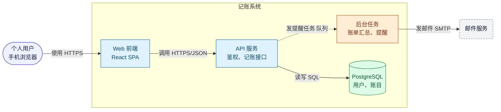

# 架构图规范

目标：看一眼就能知道整个系统由哪些部分组成、它们怎么连、数据往哪流。图以 Mermaid 源码为准（可以 diff，GitHub 和多数编辑器直接渲染）。

## 一套图，各管一层

| 图 | 放在 | 回答什么 | Mermaid 类型 |
|---|---|---|---|
| 系统上下文（C4 第 1 层） | architecture.md 第 2 章 | 谁在用、和哪些外部系统打交道 | `flowchart LR` |
| 容器视图（C4 第 2 层） | 第 3 章 | 由哪些可部署单元组成（前端、服务、数据库、队列），怎么通信 | `flowchart LR` |
| 组件视图（C4 第 3 层） | 第 4 章，只给复杂的容器画 | 一个容器内部的模块（M-xx）和依赖方向 | `flowchart TB` |
| 数据模型 | 第 5 章 | 核心实体和关系 | `erDiagram` |
| 关键流程 | 第 6 章，每个 P0 核心流程一张 | 一次请求经过哪些部分、同步还是异步 | `sequenceDiagram` |
| 部署 | 第 7 章 | 跑在哪里、几个环境、流量入口 | `flowchart LR` |

一张图只讲一层，不要把上下文、容器、部署画在一起。

## 画法

1. **节点不超过 15 个**（`doc-check.py arch` 超过 20 个会警告）。多了就拆成两张，或把一组节点收成一个子图。
2. **用 `subgraph` 画边界**：系统边界、信任边界（公网 / 内网）、层（接入层、服务层、数据层）。子图标题写清楚边界是什么。
3. **方向一致**：上下文、容器、部署图从左到右（用户在最左，外部系统和数据在右）；组件图从上到下（依赖向下）。
4. **每条连线都写标签**：动词加协议，如 `-->|下单 HTTPS/JSON|`、`-.->|订单事件 Kafka|`。同步用实线 `-->`，异步用虚线 `-.->`。
5. **节点写名字和一句职责**：`api["API 服务<br/>鉴权、业务接口"]`；数据库用圆柱 `db[("PostgreSQL<br/>用户、订单")]`；外部系统用圆角 `pay("支付渠道")`；用户用 `user(["个人用户"])`。
6. **统一配色**：每张 flowchart 末尾加下面这组 `classDef`，按类别给节点上色，不在图里写别的颜色：

```
classDef person fill:#eef2ff,stroke:#4f46e5,color:#1e1b4b
classDef ours fill:#e0f2fe,stroke:#0369a1,color:#0c4a6e
classDef store fill:#dcfce7,stroke:#15803d,color:#14532d
classDef async fill:#ffedd5,stroke:#c2410c,color:#7c2d12
classDef external fill:#f3f4f6,stroke:#6b7280,color:#111827,stroke-dasharray:4 3
```
   `person` 用户；`ours` 我们的服务和前端；`store` 数据库、缓存、对象存储；`async` 队列、定时任务、事件总线；`external` 外部系统（虚线边框）。
7. 模块节点的 id 用 `M01` 这样的形式，显示名里写 `M-01`，和正文的模块编号对上。
8. 不画实现细节（类、函数），那是 detailed-design.md 的事。

## 示例（容器视图）



## 检查

- `doc-check.py arch` 机械检查：每章该有的图都在、节点数、flowchart 有没有用统一配色、模块编号对得上。
- **看渲染结果**：宿主能渲染 Mermaid 时（例如装了 mermaid-cli 的 `mmdc`，或有能把 Markdown 渲染成图片的工具），把每张图渲染成 PNG 或 SVG 后查看：文字有没有重叠、连线是否缠成一团、子图边界是否清楚、在手机宽度下标签能否看清。有问题就拆图或调整方向。渲染不了时在评审记录里写明“未渲染检查”。（渲染命令在不同宿主上的写法待实机核实。）
